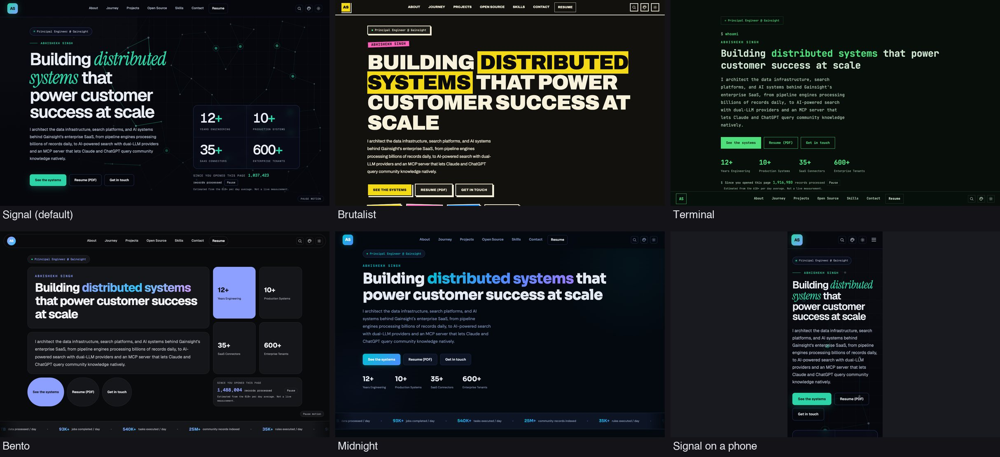
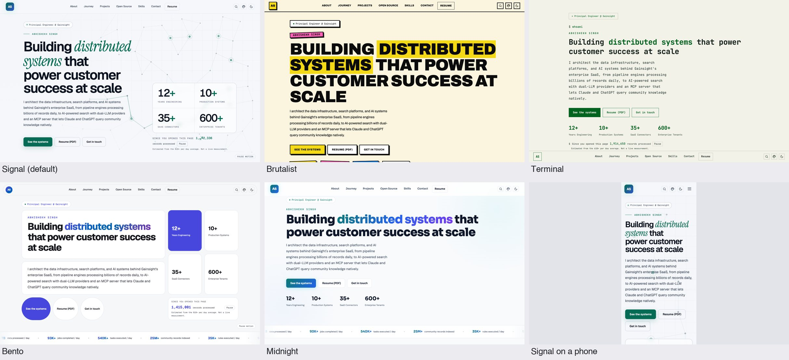

# abhishekhsingh.github.io

Personal portfolio website. Principal Engineer at Gainsight.

🔗 **Live**: [abhishekhsingh.github.io](https://abhishekhsingh.github.io)

Plain HTML, CSS and vanilla JavaScript on GitHub Pages. No framework and no bundler. The only build step inlines the default CSS into `index.html`.

## Themes

Five themes, each in dark and light mode: **Signal** (the default), Brutalist, Terminal, Bento and Midnight. Pick one with the palette button in the nav, press Alt+Shift+T, or open a link like `?theme=terminal`.

A new visit always opens in Signal dark. A choice lasts for the tab. To keep it for later visits, turn on **Remember my choice** in the theme picker.

How the themes are built, how to add one and the measured performance are in [docs/themes.md](docs/themes.md).

Dark mode:



Light mode:



## On the page

- Animated architecture diagrams with step-through request traces and short case studies.
- A recorded `mcp-halflist` session behind the "Try it" box.
- A hero graph, a throughput estimate and count-up numbers. A Pause control and `prefers-reduced-motion` turn the motion off.
- Ctrl or Cmd+K opens a command palette.
- A chapter rail on wide screens and a print stylesheet that lays out a clean copy.

## Run it locally

```
python3 -m http.server 8000
```

Then open http://localhost:8000. Any static server works.

## Editing styles

The CSS source is in `css/`. Signal and the base styles are inlined into `index.html`, so after editing `css/base.css` or `css/themes/signal.css` run:

```
python3 scripts/build.py          # inline the CSS into index.html
python3 scripts/build.py --check  # fail if index.html is out of date
```

The other themes are separate files that load when someone picks them.

## Other pieces

- The weekly job in `.github/workflows/stats.yml` refreshes `data/stats.json` (PyPI downloads and release tags). It can also be run by hand from the Actions tab.
- `assets/demo/` holds the recorded `mcp-halflist` runs.
- `assets/logos/` holds the technology logos. See the note in that folder about trademarks.
- `scripts/` has the CSS inliner and the generators for the hero graph and background art.

## Working on it

Changes go on the `dev` branch and reach `main` through a pull request. GitHub Pages deploys from `main`.
